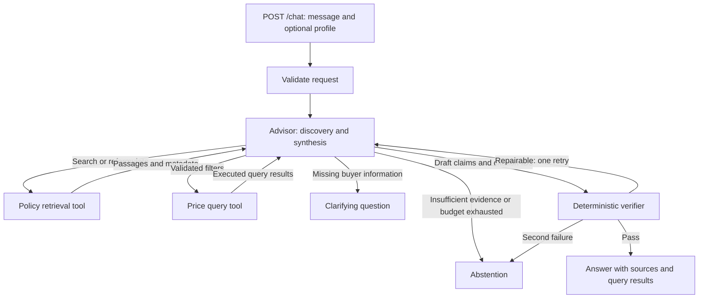

# Kopi & Keys

HDB Resale Policy & Price Benchmark Advisor — SE201 G1T5.

This is the backend starting point. It runs the proposed control flow with a
**demo advisor and fictional policy passages**. It does not give HDB advice or
connect to an LLM yet.

## Run locally (Windows PowerShell)

```powershell
py -m venv .venv
.\.venv\Scripts\python.exe -m pip install -e ".[dev]"
.\.venv\Scripts\python.exe -m uvicorn kopi_keys.main:app --reload
```

Open http://127.0.0.1:8000/docs for the API playground.

`POST /chat` example:

```json
{
  "message": "Explain the demo programme and its related condition."
}
```

This deliberately retrieves a programme passage, discovers a reference to a
second condition, retrieves again, then verifies the cited answer. Responses
include `mode: "demo"` and a small execution trace. Real HDB questions abstain
until official evidence and a model adapter are connected.

Other requests:

- `{"message": "What are resale prices?"}` demonstrates clarification.
- `{"message": "What grants can we get?"}` demonstrates abstention without official evidence.
- `GET /health` reports service health and demo mode.

## Architecture



The Advisor sees one shared state: the request, buyer profile, accumulated
passages, price result, previous queries, verification errors and call counts.
Tool results return to the Advisor, so it can request missing evidence. Code
enforces three retrieval calls, one price call, one verification repair and an
overall Advisor-step limit. Repeated identical policy queries stop the turn.

## Project layout

```text
backend/kopi_keys/
  main.py           FastAPI entry point and dependency wiring
  schemas.py        Validated request, decision, evidence and response models
  state.py          Shared LangGraph state
  workflow.py       Advisor/tool/verifier graph and budgets
  advisor.py        Advisor interface and temporary demo implementation
  verifier.py       Citation and source-metadata checks
  tools/
    policy.py       Retrieval interface and fictional demo retriever
    price.py        Price-tool interface; currently reports unconfigured
tests/              Workflow and API checks
docs/architecture.md  Integration plan and current boundaries
data/README.md      Planned policy and transaction data layout
```

## Check the foundation

```powershell
.\.venv\Scripts\python.exe -m pytest
```

The API is stateless between requests. A supplied buyer profile is shared within
that request; conversation memory and profile extraction will be added later.
The verifier checks citation presence, known source IDs and superseded flags.
It cannot establish semantic entailment or certify eligibility.

The graph follows the [LangGraph Graph API](https://docs.langchain.com/oss/python/langgraph/graph-api).
The API follows [FastAPI's application pattern](https://fastapi.tiangolo.com/tutorial/first-steps/).
