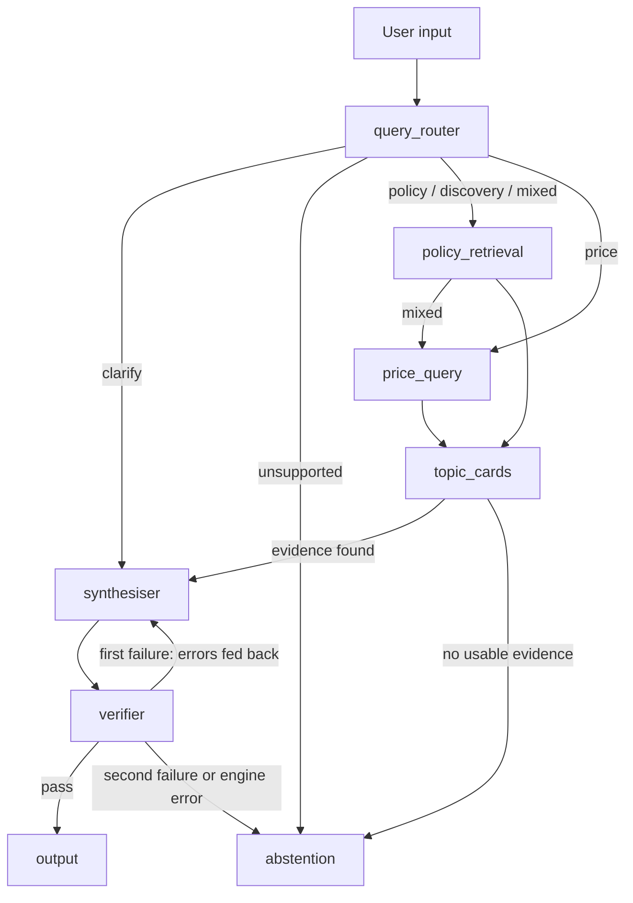

# Kopi & Keys

HDB Resale Policy & Price Benchmark Advisor — SE201 G1T5.

The backend is one LangGraph harness whose nodes match the boxes on our
architecture diagram (proposal Appendix C). Some boxes are still placeholders;
see [docs/architecture.md](docs/architecture.md) for what is real, what is
stubbed and who owns each part.

## Run locally

Windows PowerShell:

```powershell
py -m venv .venv
.\.venv\Scripts\python.exe -m pip install -e ".[dev]"
.\.venv\Scripts\python.exe -m pytest -q
.\.venv\Scripts\python.exe -m uvicorn kopi_keys.main:app --reload
```

macOS / Linux:

```bash
python3 -m venv .venv
.venv/bin/python -m pip install -e ".[dev]"
.venv/bin/python -m pytest -q
.venv/bin/python -m uvicorn kopi_keys.main:app --reload
```

The editable install (`pip install -e`) is required: without it, imports of
`kopi_keys` fail. Open http://127.0.0.1:8000/docs for the API playground.

Example `POST /chat` requests:

- `{"message": "What is the demo grant policy?"}` retrieves a fictional demo
  passage and returns a cited answer.
- `{"message": "What is the resale price?"}` asks for the missing town and flat type.
- `{"message": "What grants can we get?"}` abstains: no official policy evidence is loaded yet.
- `{"message": "Tell me a joke."}` abstains as out of scope.

Each response includes its `route` and a `trace` of the nodes that ran.

## Price synthesis on a local CPU model

The price path uses a real local model through Ollama. See
[docs/price-synthesis-and-verification.md](docs/price-synthesis-and-verification.md)
for setup, then:

```powershell
.\scripts\setup_ollama.ps1
.\.venv\Scripts\python.exe -m kopi_keys.cli --input examples\price_sql_result.json
.\.venv\Scripts\python.exe scripts\run_price_cases.py
```

## Architecture



## Project layout

```text
backend/kopi_keys/
  main.py               FastAPI entry point; calls graph.py only
  graph.py              The single LangGraph harness (one node per diagram box)
  state.py              The single GraphState shared by every node
  schemas.py            Request, evidence, price result, draft and response models
  llm.py                Shared Ollama client (CPU only)
  cli.py                Run one SQL price result through the full graph
  components/
    query_router.py     Query Router: classify, extract filters, validate
    policy_retrieval.py Policy Retrieval Tool (demo retriever for now)
    price_query.py      Price Query Tool (not connected yet)
    topic_cards.py      Topic cards for discovery (placeholder)
    synthesiser.py      Synthesiser Agent (also covers discovery wording)
    verifier.py         Verifier: citations, numbers, provenance, suggestions
    abstention.py       Fixed abstention messages
  evaluation/           Evaluation runner, metrics and baselines (placeholder)
data/
  evaluation/           Development set and labels; held-out set stays local
  topic_cards/          Reviewed topic cards (placeholder)
docs/                   Architecture and component handoff notes
examples/price_cases/   Synthetic SQL results for the price path
scripts/                Ollama setup and batch runners
tests/                  One test file per component, plus graph and API tests
```
