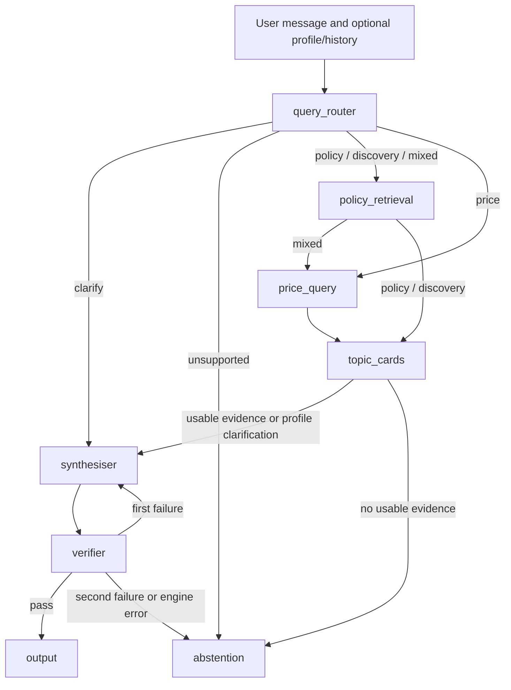

# Architecture

The backend uses one LangGraph workflow (`backend/kopi_keys/graph.py`) and one
shared `GraphState` (`state.py`). FastAPI calls that graph; the React frontend
uses its streaming endpoint. This describes the implementation after PR #8,
not every feature originally proposed for the final system.

## Changes from the proposal

Discovery is merged into the Synthesiser rather than a separate LLM agent.
The query router and topic-card matching are currently rules and regex. Code
chooses up to three cited suggestions, and the output node renders them. The
model selects policy excerpts and formats already-computed price statistics.

The verifier permits one synthesis repair. It does not trigger a new retrieval
query, so iterative retrieval/backtracking is not implemented.

## Components and ownership

Python module paths are relative to `backend/kopi_keys/`. Paths beginning with
`data/`, `scripts/` or `frontend/` are relative to the repository root.

| Component | File | Owner | Current implementation |
| --- | --- | --- | --- |
| Query Router | `components/query_router.py` | Breann; price rules by Tasha | Rules/regex, extraction, dates and required-field gate. Dev routing labels: 50; known gaps are listed in `tests/test_development_set_contract.py`. LLM classifier not built. |
| Discovery/topic cards | `components/topic_cards.py`, `topic_cards.py`, `data/topic_cards/` | Sandra | 12 cards, matching, profile hints, overviews, cited suggestions and grant income notes. Some inputs are not collected yet. |
| Policy retrieval/index | `components/policy_retrieval.py`, `components/policy_index.py` | Sandra; initial policy integration by Nisha | Keyword ranking plus EmbeddingGemma/ChromaDB vectors, scheme focus, deduplication and keyword fallback. Index built locally with `scripts/build_policy_index.py`. |
| Price Query Tool | `components/price_query.py`, `ingest/resale_db.py` | Tasha | Connected read-only SQLite tool, Decimal statistics, lease/floor refinements and recent transactions. |
| Income rules | `rules/`, `components/topic_cards.py` | Tasha and Sandra | Pure Python boundary checks with verified source data/conditions; notes rather than eligibility verdicts. |
| Synthesiser | `components/synthesiser.py`, `components/policy_synthesis.py`, `llm.py` | Nisha; later tuning by Sandra | Qwen2.5:3b selects structured quotes and formats prices. Clarifications and scoped citizenship-table facts can use code directly. |
| Verifier | `components/verifier.py` | Nisha; later grounding fixes by Sandra | Named numeric checks, citations, verbatim quotes, table scope, superseded sources and topic-card checks. Can retain independently verified claims. |
| Output/abstention | `graph.py`, `components/price_display.py`, `components/abstention.py` | Breann; price wording by Tasha | Verified messages or fixed abstention. Fewer than five sales are listed instead of a median summary. |
| Harness | `graph.py`, `state.py` | Breann; team integration | One graph, bounded retry and immediate abstention on model-engine failure. |
| API | `main.py` | Team | `/health`, `/chat`, `/chat/stream`, in-memory cache and model warm-up. |
| Frontend | `frontend/` | Sandra; price UI by Tasha, profile/history integration by Nisha | React chat, sources, profile, progress, recent chats, price refinement and local feedback. |
| Evaluation | `evaluation/` | Sandra | Dev loader, metrics and runner. No-tools and naive-RAG answer baselines remain TODO. |
| Tracing | Response `trace` and `@traceable` in `llm.py` | Breann; APAC setup by Nisha | Node traces in responses; optional LangSmith graph/model tracing with credentials and matching region. |

## Flow

1. The router extracts profile/filter values and chooses the route. Missing
   required inputs produce a clarification; unsupported requests abstain.
   Recognised clarification replies can resume an earlier goal.
2. Policy/discovery routes retrieve evidence. Mixed requests retrieve policy
   then query prices. Price-only requests query SQLite directly.
3. Cards can request missing personal EHG/loan inputs, supply overviews and
   suggestions, and attach verified income notes. Discovery requests generally
   receive a sidebar hint instead of being blocked by a profile question.
4. With no usable evidence, the graph abstains before generation. The default
   app uses snapshot evidence; fictional test retrievers report `demo`.
5. Synthesis uses up to three policy passages and 800 source words by default,
   or formats price values. Table facts retain source row/column context.
6. The verifier may retain independently valid claims if the resulting draft
   passes all checks. Otherwise, one repair is allowed, followed by abstention
   on another failure. Model errors abstain immediately. Output uses verified
   parts only.

## Assumptions and boundaries

- Price requests without dates use the last 12 months relative to the current
  month. Named dates are parsed; coverage is limited to the dataset snapshot.
- SQLite selects transactions; Python Decimal code computes statistics
  deterministically. The LLM does not calculate or choose the figures.
- Mixed requests can answer supported policy when prices are unavailable.
- The router has a price required-field gate. Personal EHG/loan requests also use
  topic-card requirements; collecting those inputs is not a complete assessment.
- The API accepts client-owned history for bounded clarification handling.
  Chats stay in the browser; there is no server conversation database. An
  in-memory response cache and optional LangSmith traces are separate features.
- Source and numeric checks do not establish complete relevance, policy coverage
  or final eligibility. An in-scope request can still abstain.
- Fresh held-out data stays outside the repo and is not used for tuning.
  Previously exposed archived questions are retired, not unseen evaluation data.

See [the root README](../README.md) for current checks and known limitations,
and [the evaluation guide](../backend/kopi_keys/evaluation/README.md) for metrics.
